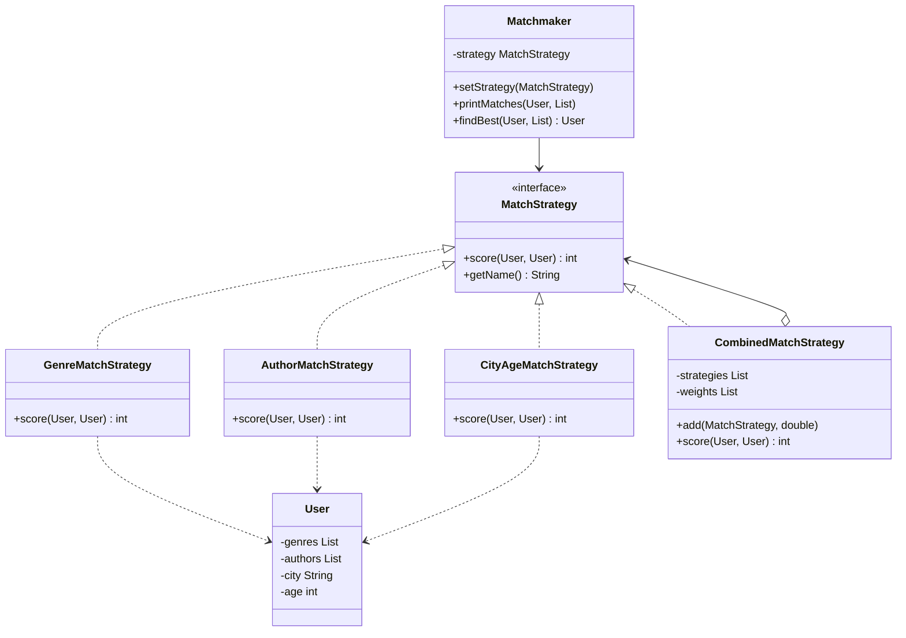

# MD1 - Кітап сүйгіштер клубындағы Strategy паттерні

Курс: Designing Applications Using Design Patterns
Команда: (өз аты-жөніңізді осында жазыңыз)

## Біздің тапсырма

Бізге Кітап сүйгіштер клубы жобасы берілді (жас кітап сүйгіштерге арналған қарапайым танысу клубы).
**Strategy** паттернінің тапсырмасы: жұпты таңдау әртүрлі тәсілмен жұмыс істеуі керек:

- жанрлар бойынша
- авторлар бойынша
- жасы мен қаласы бойынша
- аралас формула бойынша

Әр тәсіл бір ортақ интерфейсі бар бөлек класс болуы керек, сонда ескі кодты өзгертпей жаңа тәсіл қосуға болады.

## Файлдар

- `before/Main.java` - мұғалімнің түпнұсқа коды (тек 2 стратегия: жанрлар, қала + жас)
- `after/Main.java` - өзгертуден кейінгі біздің кодымыз (4 стратегия)

## Мәселе неде болды

Ескі кодта тек екі стратегия болды: `GenreMatchStrategy` және `CityAgeMatchStrategy`.
`User` сүйікті авторларды білмегендіктен, авторлар бойынша таңдау мүмкін емес еді.
Сондай-ақ бірнеше ережені бір формулаға біріктіру мүмкіндігі де жоқ болатын.

## Біз нені өзгерттік

1. `User` класына сүйікті авторлар тізімі қосылды: `addAuthor()` және `getAuthors()`.
2. Жаңа `AuthorMatchStrategy` класы: әр ортақ автор үшін 15 балл.
3. `CityAgeMatchStrategy` жасы мен қаласы үшін қалды (бір қала болса 20 балл,
   жас айырмасы 2 жылға дейін болса 10 балл, 5 жылға дейін болса 5 балл).
4. Жаңа `CombinedMatchStrategy` класы: басқа стратегиялардың тізімін салмақтарымен сақтап,
   олардың баллдарын қосады: `score = жанр * 1.0 + автор * 0.5 + қала/жас * 1.0`.
   Формулаға жаңа стратегияны `add(strategy, weight)` арқылы қосуға болады.
5. `main()` ішінде бір `Matchmaker` арқылы 4 стратегияның бәрін көрсеттік, ал хабарландыру үшін
   ең жақсы жұпты аралас формула арқылы таптық.

`MatchStrategy` және `Matchmaker` **өзгерген жоқ**. Басқа паттерндер
(Singleton, Factory, Observer) бұрынғыдай жұмыс істейді.

## Нәтиже мысалы (Айгерим үшін таңдау)

| Адам  | Жанрлар | Авторлар | Қала + жас | Аралас |
| ----- | ------- | -------- | ---------- | ------ |
| Арман | 20      | 30       | 30         | 65     |
| Дана  | 0       | 0        | 10         | 10     |
| Тимур | 10      | 15       | 25         | 43     |

Арман үшін аралас формула: 20 * 1.0 + 30 * 0.5 + 30 * 1.0 = 65.

## Class diagram



## Жобадағы паттерндер

| # | Паттерн   | Қайда                                                                                              |
| - | --------- | -------------------------------------------------------------------------------------------------- |
| 1 | Singleton | ClubDatabase                                                                                       |
| 2 | Factory   | NotifierFactory                                                                                    |
| 3 | Strategy  | MatchStrategy, GenreMatchStrategy, CityAgeMatchStrategy, және енді AuthorMatchStrategy, CombinedMatchStrategy (біз қостық) |
| 4 | Observer  | NewsBoard                                                                                          |

## Қалай іске қосу керек

Java 11 немесе жаңа нұсқасы керек.

```
cd after
javac Main.java
java Main
```

немесе javac-сыз:

```
java after/Main.java
```

Ескі нұсқа да `before` папкасынан дәл солай іске қосылады.

Windows-та консольде кириллица қате көрінсе, алдымен `chcp 65001` командасын орындаңыз.
