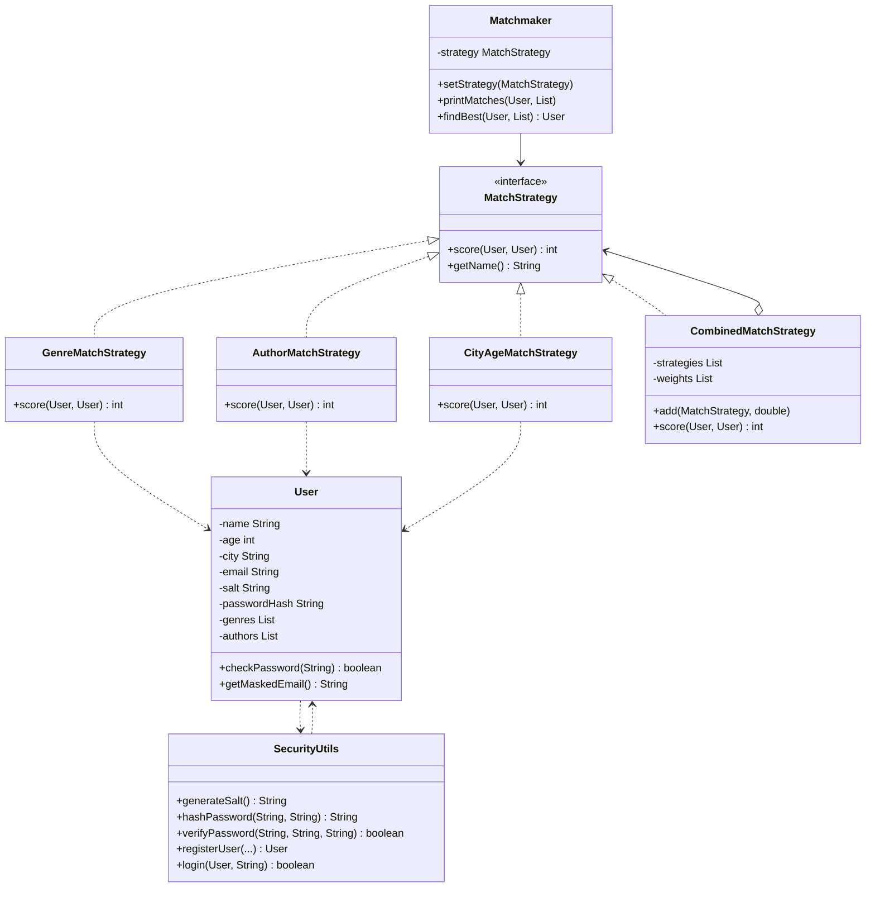

# MD1 - Кітап сүйгіштер клубындағы Strategy паттерні және қауіпсіздік

Курс: Designing Applications Using Design Patterns
Команда: (өз аты-жөніңізді осында жазыңыз)

## Біздің тапсырма

Бізге Кітап сүйгіштер клубы жобасы берілді (жас кітап сүйгіштерге арналған қарапайым танысу клубы).
**Strategy** паттернінің тапсырмасы: жұпты таңдау әртүрлі тәсілмен жұмыс істеуі керек:

- жанрлар бойынша
- авторлар бойынша
- жасы мен қаласы бойынша
- аралас формула бойынша

Әр тәсіл бір ортақ интерфейсі бар бөлек класс болуы керек, сонда ескі кодты өзгертпей жаңа тәсіл қосуға болады.
Сонымен қатар жобаға қауіпсіз тіркелу мен кіру қосылды (`SecurityUtils`).

## Файлдар

- `before/Main.java` - мұғалімнің түпнұсқа коды (тек 2 стратегия: жанрлар, қала + жас)
- `after/Main.java` - өзгертуден кейінгі біздің кодымыз (4 стратегия + қауіпсіздік)

## Мәселе неде болды

Ескі кодта тек екі стратегия болды: `GenreMatchStrategy` және `CityAgeMatchStrategy`.
`User` сүйікті авторларды білмегендіктен, авторлар бойынша таңдау мүмкін емес еді.
Бірнеше ережені бір формулаға біріктіру мүмкіндігі де жоқ болатын.
Тіркелу кезінде деректер тексерілмейтін, ал құпиясөз сақталмайтын.

## Біз нені өзгерттік

### Strategy бөлігі

1. `User` класына сүйікті авторлар тізімі қосылды: `addAuthor()` және `getAuthors()`.
2. Жаңа `AuthorMatchStrategy` класы: әр ортақ автор үшін 15 балл.
3. `CityAgeMatchStrategy` жасы мен қаласы үшін қалды (бір қала болса 20 балл, жас айырмасы 2 жылға дейін болса 10 балл, 5 жылға дейін болса 5 балл). Қала аттарын салыстыру кезінде бас әріп пен кіші әріп ескерілмейді.
4. Жаңа `CombinedMatchStrategy` класы: басқа стратегиялардың тізімін салмақтарымен сақтап, олардың баллдарын қосады:
   `score = жанр * 1.0 + автор * 0.5 + қала/жас * 1.0`.
   Формулаға жаңа стратегияны `add(strategy, weight)` арқылы қосуға болады.
5. `Matchmaker.findBest()` әдісінде бастапқы балл `-1` болды, сондықтан барлық адам 0 балл алса да, бағдарлама біреуін таңдайды.

### Қауіпсіздік бөлігі (`SecurityUtils`)

- Тіркелу кезінде аты (тек латын әріптері, 2-30), жасы (14-30), email пішімі және құпиясөз күші тексеріледі. Бұл `' OR '1'='1` сияқты қате деректерді өткізбейді.
- Құпиясөз ашық күйде сақталмайды: әр пайдаланушыға кездейсоқ тұз (salt) жасалып, SHA-256 арқылы 10000 рет хэштеледі.
- Құпиясөзді тексергенде `MessageDigest.isEqual` қолданылады.
- Үш рет қате құпиясөз енгізсе, аккаунт бұғатталады.
- Email экранда жасырынып шығады (`d***@mail.kz`).

`MatchStrategy` интерфейсі мен `Matchmaker` құрылымы **өзгерген жоқ**.

## Нәтиже мысалы (Danieldin үшін таңдау)

| Адам      | Жанрлар | Авторлар | Қала + жас | Аралас |
| --------- | ------- | -------- | ---------- | ------ |
| Daulet    | 20      | 30       | 30         | 65     |
| Asylzhan  | 10      | 15       | 30         | 48     |
| Nursultan | 0       | 0        | 10         | 10     |

Daulet үшін аралас формула: 20 * 1.0 + 30 * 0.5 + 30 * 1.0 = 65.
Ең көп балл Daulet-те, сондықтан ол ең жақсы жұп болып таңдалады.

## Class diagram



## Жобадағы паттерндер

| # | Паттерн  | Қайда                                                                                                   |
| - | -------- | ------------------------------------------------------------------------------------------------------- |
| 1 | Strategy | MatchStrategy, GenreMatchStrategy, CityAgeMatchStrategy, және енді AuthorMatchStrategy, CombinedMatchStrategy (біз қостық) |

Бұл нұсқада Singleton, Factory және Observer жоқ. `SecurityUtils` паттерн емес, ол көмекші (utility) класс.

## Қалай іске қосу керек

Java 11 немесе жаңа нұсқасы керек.

```
cd after
javac Main.java
java Main
```

немесе javac-сыз:

```
java after/Main.java
```

Windows-та консольде әріптер қате көрінсе, алдымен `chcp 65001` командасын орындаңыз.
